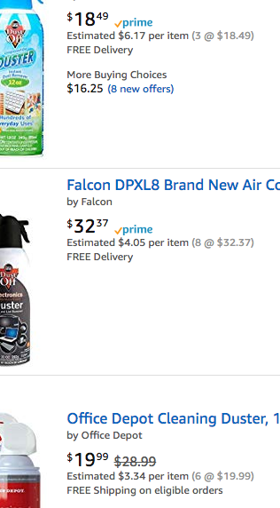
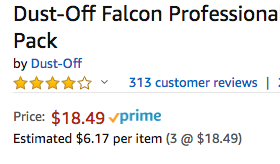

# Greasemonkey/Tampermonkey Scripts

This is my collection of GM scripts.

## 8 Tracks Hide Album Covers

This script will hide album covers with a gradient.
I developed this because some of the tracks I listen to have album covers that
may be offensive in a work environment (NSFW).

## Amazon Price Per Item

This script adds an estimated price per item. I say estimated because
the only way to know if the item is sold in a pack is by using hints based
on the title.

It will show the price on both the search and item details page.

## Gitlab MR Pipeline Controls

Adds a one click button next to the pipeline status icon, both on the merge
request list and on the head pipeline of a single merge request. What you get
depends on the pipeline:

- Still going (running, pending, created, preparing, scheduled, waiting for a
  resource): a red `✕` that cancels the whole pipeline.
- Failed or canceled: a blue `↻` that retries it, re-running only the failed
  and canceled jobs, exactly like GitLab's own Retry button.
- Anything else: no button.

Neither asks for confirmation, and the button swaps itself over as soon as
the pipeline changes state, so a pipeline you just retried can be canceled
again right away.

On the list, GitLab does not repaint the pipeline icon when you cancel or
retry, so the script does it: after the action it re-reads the real status and
redraws the icon, then keeps checking every 3 seconds until the pipeline
settles or 2 minutes pass. If the 2 minutes run out while the pipeline is
still going, a grey `?` appears next to the icon, meaning "nobody has
confirmed this status since". It disappears once the status actually changes.

On a single merge request none of that happens: GitLab keeps its own widget
up to date, so the button acts and stops. The Pipelines tab of a merge
request is left alone entirely, since GitLab already puts cancel and retry
buttons on those rows.

Both actions go through the same GraphQL mutations the GitLab UI uses, so they
need nothing beyond the session you are already signed in with.
